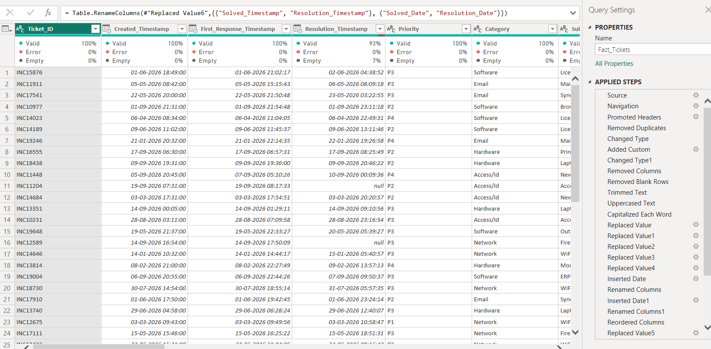
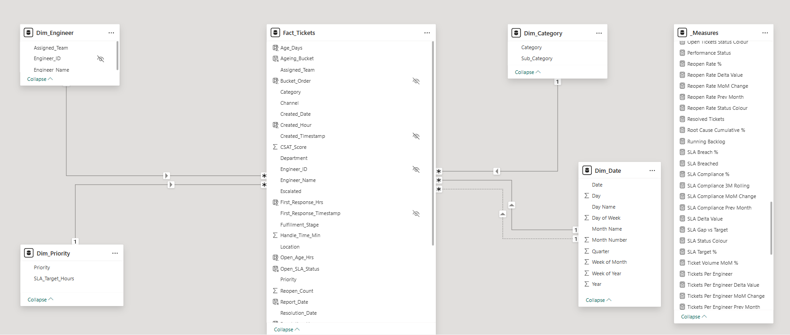
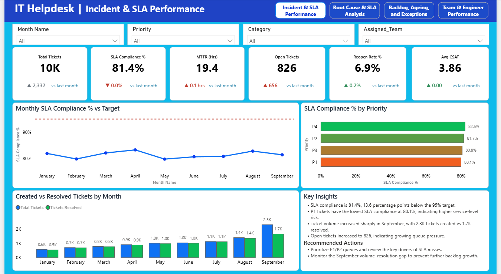
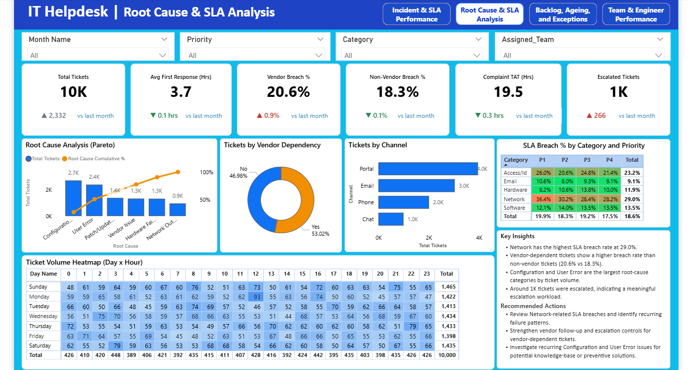
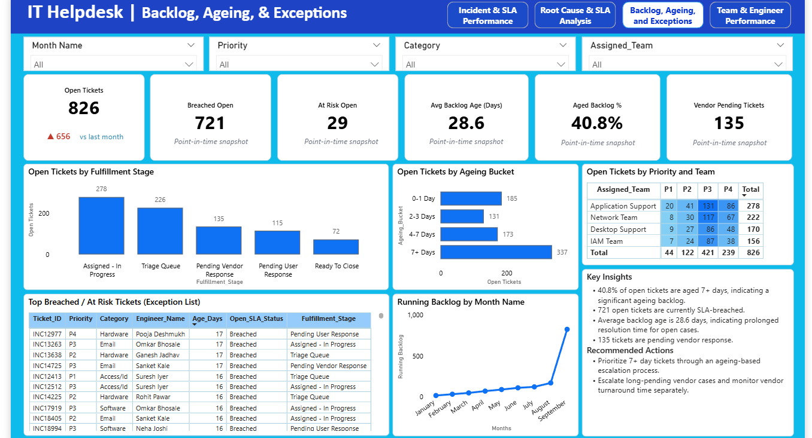
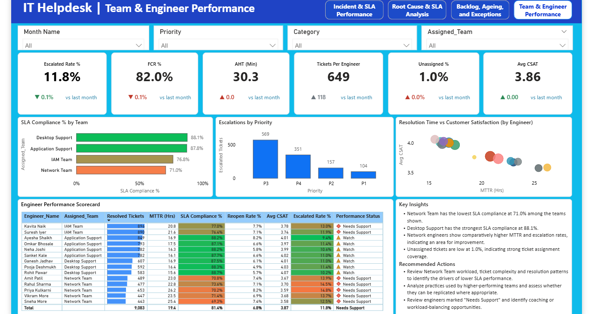
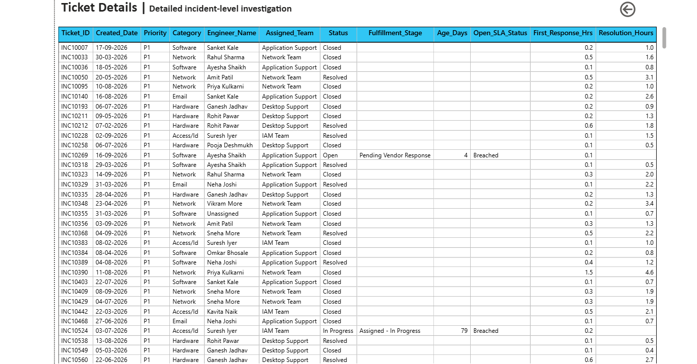
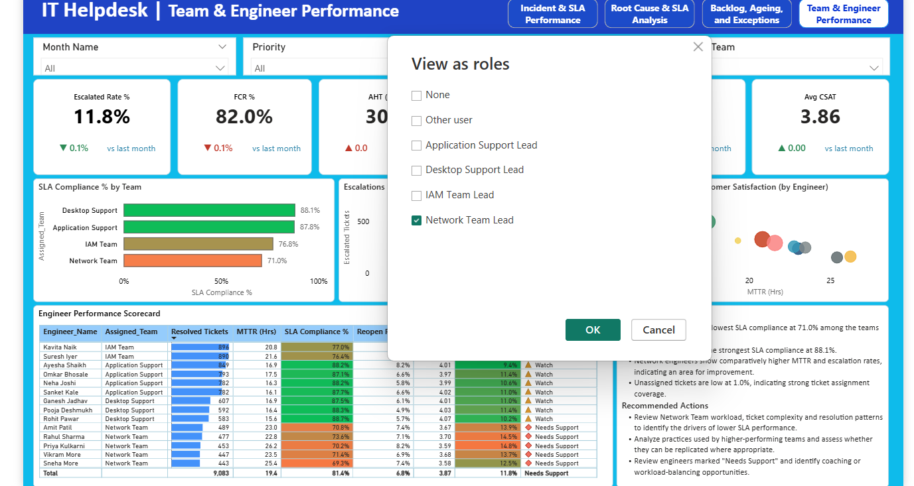
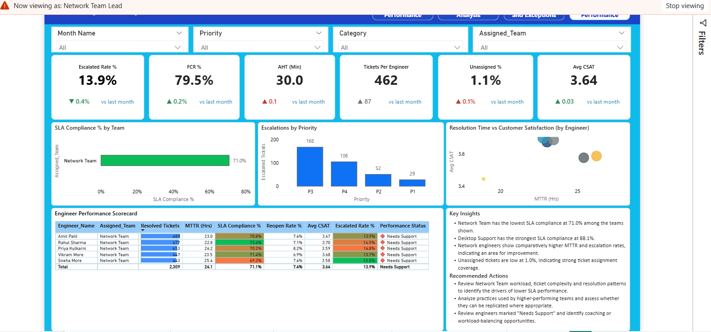

# IT Helpdesk Incident & SLA Performance Analysis

**Tech Stack:** Power BI | Power BI Desktop | Power Query | DAX | Data Modeling

## Project Overview

This project focuses on analyzing IT helpdesk incidents and monitoring Service Level Agreement (SLA) performance using Power BI. A synthetic dataset containing 10,000 incident tickets was used for portfolio demonstration and business analysis. The dashboard provides insights into ticket volume, SLA compliance, resolution time, backlog ageing, root causes, escalations, and team and engineer performance.The objective is to identify SLA breaches, monitor unresolved tickets, understand operational bottlenecks, and support data-driven decisions to improve IT support efficiency.

## Business Problem

IT support teams handle a large volume of incident tickets daily. However, poor SLA compliance, delayed resolutions, increasing ticket backlogs, recurring issues, and uneven workload distribution can affect service quality and operational efficiency.
The goal of this project is to analyze helpdesk ticket data, identify SLA breaches and backlog issues, understand the major causes of incidents, and evaluate team and engineer performance to help improve IT support operations.

## Project Objectives

- Analyze IT helpdesk ticket volume and SLA compliance.
- Identify SLA breaches and monitor unresolved tickets.
- Evaluate ticket backlog and ageing patterns.
- Analyze incident root causes and recurring issues.
- Measure resolution time, reopen rate, and customer satisfaction.
- Compare team and engineer performance.
- Provide actionable insights to support better workload management and timely ticket resolution.

## Tools & Technologies

- **Microsoft Excel:** Used as the source file for helpdesk incident data.
- **Power Query:** Used for data cleaning, transformation, and preparation.
- **Data Modeling:** Used to organize ticket data and related dimension tables for effective analysis.
- **Power BI Desktop:** Used to build interactive dashboards and visualize key performance indicators.
- **DAX (Data Analysis Expressions):** Used to create calculated measures and columns for SLA analysis, ticket ageing, resolution time, and performance metrics.

## Data Preparation & Modeling

### Data Cleaning & Transformation

Data cleaning and transformation were performed in Power Query to improve data quality, maintain consistency, and prepare the dataset for analysis.

- Removed duplicate Ticket IDs and blank rows.
- Handled missing values and inconsistent text entries.
- Trimmed extra spaces and corrected text inconsistencies.
- Standardized data types for accurate calculations.
- Created date-related fields for time-based reporting.
- Prepared and transformed data for modeling and analysis.

**Power Query Applied Steps**

The Power Query Editor was used to apply and track data cleaning and transformation steps before loading the data into Power BI.

### Data Modeling
The project uses a star-schema data model with Fact_Tickets as the central fact table connected to dimension tables such as Dim_Date, Dim_Engineer, Dim_Category, and Dim_Priority. This structure supports organized data analysis and reporting across different helpdesk dimensions.

## DAX: Calculated Columns & Measures
- Created calculated columns for Created Hour, Resolution Hour, First Response Hour, Age Days, Ageing Bucket, Open SLA Status and SLA Breach Flag.
- Developed DAX measures to analyze SLA Compliance, Mean Time to Resolution (MTTR), Open Tickets, Backlog Ageing, Reopen Rate, and other performance indicators.

### DAX Documentation
The following files contain the DAX calculations used in this project.

[DAX Measures](DAX/Measures.dax) – KPI calculations, SLA metrics, MoM changes, delta values, status indicators, and other measures.

[Calculated Columns](DAX/Calculated_Columns.dax) – Calculated columns used for ticket ageing, SLA tracking, response time, and resolution time.

## Dashboard Pages

### 1. Incident & SLA Performance
Provides an overview of helpdesk operations through key performance indicators, including SLA Compliance, Mean Time to Resolution (MTTR), Open Tickets, Reopen Rate and other incident performance metrics.

### 2. Root Cause & SLA Analysis
Analyzes incident root causes and SLA performance to identify patterns associated with SLA breaches and resolution delays.

### 3. Backlog, Ageing & Exceptions
Focuses on unresolved tickets, ticket ageing categories, overdue incidents, and SLA-breached open tickets to highlight areas requiring immediate attention.

### 4. Team & Engineer Performance
Evaluates team-level and engineer-level performance using SLA compliance, ticket resolution, workload, and other relevant performance metrics.

## Power BI Dashboard

Explore the complete interactive Power BI dashboard by downloading the project file.

[Download the Power BI Project (.pbix)](PowerBI/IT_Helpdesk_Incident_SLA_Analysis.pbix)

## Key Business Insights

- **SLA Compliance:** Overall SLA compliance is 81.4%, which is below the target of 95%, indicating scope for improvement in timely ticket resolution.
- **Open Ticket Backlog:** There are 826 open tickets, of which 721 have breached their SLA, highlighting the need for focused backlog management.
- **Ticket Ageing:** The average backlog age is 28.6 days, and 40.8% of open tickets have been pending for more than 7 days.
- **Team Performance:** Network Team has an SLA compliance rate of 71.0%, compared with 88.1% for Desktop Support, indicating a performance gap between the teams.
- **Root Cause Analysis:** Root cause analysis helps identify incident categories associated with SLA breaches and resolution delays, supporting further investigation into recurring issues.
- **Operational Monitoring:** Team-level, engineer-level, and ticket-ageing analysis helps identify areas requiring attention and supports better workload management.

## Business Recommendations

- **Improve SLA Compliance:** Investigate the reasons for SLA breaches and strengthen ticket prioritization to move overall compliance closer to the 95% target.
- **Reduce Ticket Backlog:** Prioritize open tickets with breached SLAs and assign clear resolution timelines to reduce pending incidents.
- **Address Ageing Tickets:** Introduce ageing-based escalation rules to ensure that long-pending tickets receive timely attention.
- **Improve Team Performance:** Investigate the reasons behind lower SLA compliance in Network Team and identify improvement opportunities through workload balancing and process reviews.
- **Investigate Root Causes:** Analyze recurring incident categories and address underlying issues to reduce repeated tickets and resolution delays.
- **Optimize Workload Distribution:** Monitor team and engineer workloads to identify imbalances and support more effective ticket assignment.

## Interactive Features

- **Interactive Slicers:** Filter dashboard data to explore incidents based on available categories and dimensions.
- **Page Navigation:** Navigate between the four dashboard pages for a structured analysis of helpdesk performance.
- **Drill-through Analysis:** Created a dedicated drill-through page to view detailed ticket-level information based on the selected data context. Users can navigate from summary visuals to the Ticket Details page to investigate specific incidents. The screenshot demonstrates an example of P1 (Priority 1) ticket details, allowing users to investigate high-priority incidents from summary-level visuals.

- **KPI Cards and Visualizations:** Monitor key performance indicators and identify patterns in SLA compliance, ticket backlog, ageing, and team performance.
- **Row-Level Security (RLS):** Configured and tested role-based data access for four support teams, including Network Team Lead and Desktop Support Team Lead, to ensure that users can view data relevant to their assigned teams.

**RLS Role Configuration**

**RLS Validation Example — Network Team**

## Project Outcome

This project demonstrates the use of Power BI to transform raw IT helpdesk ticket data into meaningful operational insights.
The dashboard enables users to monitor SLA compliance, analyze ticket backlogs and ageing, investigate incident root causes, and evaluate team and engineer performance.
Interactive dashboards, drill-through analysis, and Row-Level Security (RLS) provide deeper insights into ticket-level details and support team-specific data analysis.
The analysis highlights opportunities to improve SLA compliance, reduce pending tickets, investigate recurring issues, and optimize workload distribution.

